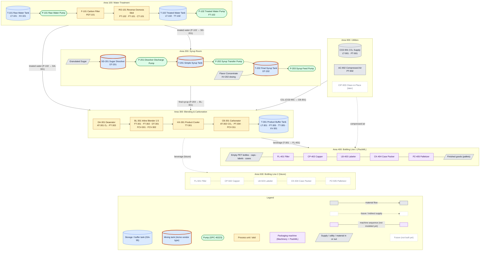
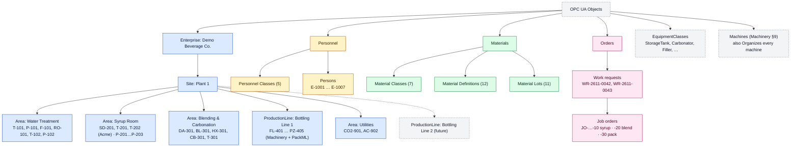
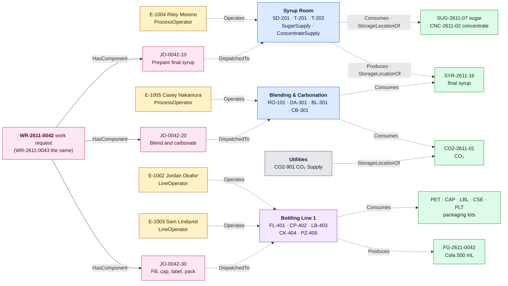

# Virtual Beverage Plant: Diagrams

Details (ratings, instruments, connections, IDs): `PLANT_DESIGN.md` (personnel, materials and orders: §8). Each diagram is also exported as a `.mmd` file in this folder for Mermalaid; re-export after edits.

Tags follow ISA-5.1 style. Area numbers: 100 Water Treatment, 200 Syrup Room, 300 Blending & Carbonation, 400 Bottling Line 1, 500 Bottling Line 2 (future, with injected problems for the hack-a-thon), 900 Utilities. Instrument letters: LT level, FT flow, TT temperature, PT pressure, DT density/Brix, CT conductivity, AT analyzer (CO₂), XV on/off valve, FCV flow control valve.

## 1. Process flow (material flow)

Areas are stacked top to bottom, and each area reads left to right. Arrows *between* areas connect the areas themselves; each label names the actual equipment at each end. That's needed because Mermaid ignores a subgraph's own direction whenever its inner nodes link outside it.

**Legend** (also drawn in the diagram):

| Shape / color | Meaning | Modeled with |
|---|---|---|
| Blue cylinder, blue outline | Storage / buffer tank | ISA-95 Equipment + EquipmentClass |
| Blue cylinder, thick orange outline | Mixing tank | Vendor `MixingTankType` (Acme profile, non-standard) |
| Green stadium | Pump | Pumps (OPC 40223) `PumpType` |
| Amber rectangle | Process unit or skid (filter, RO, deaerator, blender, cooler, carbonator) | ISA-95 Equipment + Machinery AddIns + PA-DIM instruments |
| Purple rectangle | Packaging machine | PackML `PackMLBaseObjectType` + Machinery AddIns |
| Grey parallelogram | External supply, utility, or material entering or leaving the plant | ISA-95 Equipment or not modeled |
| Dashed white box | Future scope (Line 2, CIP) | not built yet |
| Solid arrow | Material flow (direction of flow) | Pumps ports (`Direction` In/Out) joined by a connection reference (see STANDARDS_COVERAGE) |
| Dotted arrow | Future or indirect supply (e.g. compressed air to the whole line) | not modeled yet |
| Plain line between machines | Machine sequence on the packaging line | **not modeled as material links yet** (decided 2026-11-05) |
| Text under a name (LT-101, FT-301, …) | Instruments on that unit (ISA-5.1 tags) | PA-DIM devices |

## 2. Address space: the top-level trees

Under OPC UA `Objects`: the ISA-95 equipment hierarchy (linked with `MadeUpOfEquipment`), and since 2026-11-16 the **Personnel**, **Materials** and **Orders** trees. EquipmentClasses and Machinery's `Machines` folder sit beside them.

Machines are **direct children of their line**. Machinery's `Machines` folder (§9) also `Organizes` FL-401 … PZ-405, plus the skids that carry Machinery building blocks, because the spec requires that entry point. In i3X, `parentId` is the line, and the `Machines` link appears only as a graph relationship with a fidelity note.

The i3X servers show this differently:
- **CESMII gateway** (with its `singleRoot` switch on, as in the demo): Demo Beverage Co. is the single root, and every other tree hangs under it.
- **i3x2ua**: shows `Objects` itself as the root.
- **UNS server**: has its own hand-made roots (`demobev`, `people`, `materials`, `orders`).

## 3. People, materials and orders: graph relationships

How the three new trees connect to the equipment. Every dotted arrow is a **non-hierarchical reference**, so in i3X it's a graph relationship, never a second parent. Read each row left to right: who operates an area, which job order runs there, and which lots it consumes, produces or stores.

- **Reading the boxes:** equipment boxes group the units in an area. The references attach to the individual units, e.g. E-1004 `Operates` SD-201, T-201 and T-202 separately, and SYR-2611-16 is `StoredIn` T-202.
- **Storage:** storage is drawn as the inverse name `StorageLocationOf` so that every arrow reads left to right. In the model, the lot holds the forward reference, `StoredIn`.
- **Job orders also consume and produce lots**, the same lots as their area: JO-…-10 consumes the sugar and concentrate lots and produces SYR-2611-16. Those edges are left out to keep the picture readable.
- **Also in the model:** each person is `DefinedByPersonnelClass`, each material definition `DefinedByMaterialClass`, and each lot `DefinedByMaterialDefinition`.
- **Source:** the `personnel`, `materials` and `orders` sections of `factory/plant/line1.yaml`.
